<!-- Generado por scripts/generate.py desde profile.toml: no editar a mano. -->

<picture><source media="(max-width: 531px), (min-width: 768px) and (max-width: 819px)" srcset="assets/hero-m.svg"><source media="(max-width: 767px), (min-width: 820px) and (max-width: 1099px)" srcset="assets/hero-t.svg"></picture>

**I build data pipelines and applied ML — from raw web data to structured insight.**  
Construyo pipelines de datos y ML aplicado: de datos crudos de la web a información estructurada.

<h3 align="center"><picture><source media="(max-width: 531px), (min-width: 768px) and (max-width: 819px)" srcset="assets/sec-1-m.svg"><source media="(max-width: 767px), (min-width: 820px) and (max-width: 1099px)" srcset="assets/sec-1-t.svg"></picture></h3>

<a href="https://adalab.epn.edu.ec/proyectos/ofertas-laborales-piif-24-05/"><picture><source media="(max-width: 531px), (min-width: 768px) and (max-width: 819px)" srcset="assets/pipeline-m.svg"><source media="(max-width: 767px), (min-width: 820px) and (max-width: 1099px)" srcset="assets/pipeline-t.svg"></picture></a>

Ongoing team project at Laboratorio ADA, EPN: job offers flow through a medallion pipeline toward a labor-market observatory. I work on architecture, deployment and pipeline workflows. <a href="https://adalab.epn.edu.ec/proyectos/ofertas-laborales-piif-24-05/">Project page</a>  
<i>Proyecto de equipo en curso del Laboratorio ADA (EPN): las ofertas laborales pasan por un pipeline medallón hacia un observatorio del mercado laboral. Mi parte: arquitectura, despliegue y flujos del pipeline.</i>

<h3 align="center"><picture><source media="(max-width: 531px), (min-width: 768px) and (max-width: 819px)" srcset="assets/sec-2-m.svg"><source media="(max-width: 767px), (min-width: 820px) and (max-width: 1099px)" srcset="assets/sec-2-t.svg"></picture></h3>

<picture><source media="(max-width: 531px), (min-width: 768px) and (max-width: 819px)" srcset="assets/achievements-m.svg"><source media="(max-width: 767px), (min-width: 820px) and (max-width: 1099px)" srcset="assets/achievements-t.svg">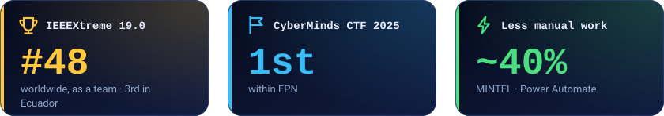</picture>

Certifications: Oracle Certified Foundations Associate · Cisco Python Essentials 1 & 2 · Generative AI on AWS · English B1  
<i>Certificaciones: Oracle Foundations Associate · Python Essentials 1 y 2 (Cisco) · IA generativa en AWS · inglés B1</i>

<h3 align="center"><picture><source media="(max-width: 531px), (min-width: 768px) and (max-width: 819px)" srcset="assets/sec-3-m.svg"><source media="(max-width: 767px), (min-width: 820px) and (max-width: 1099px)" srcset="assets/sec-3-t.svg"></picture></h3>

<a href="https://adalab.epn.edu.ec/proyectos/ofertas-laborales-piif-24-05/">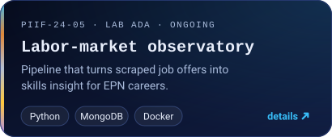</a> <a href="https://github.com/danielife05/analista-datos-enemdu">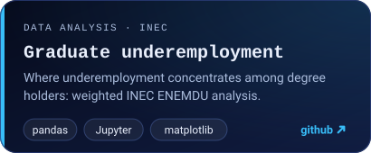</a> <a href="https://github.com/danielife05/EndoNova">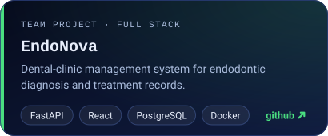</a> <a href="https://github.com/danielife05/pos-tagger-hmm-brown-corpus">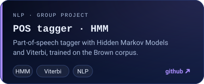</a> <a href="https://github.com/danielife05/FLoresD-clienteFTP">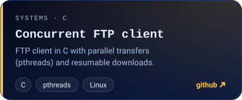</a> <a href="https://adalab.epn.edu.ec/">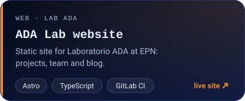</a>

<h3 align="center"><picture><source media="(max-width: 531px), (min-width: 768px) and (max-width: 819px)" srcset="assets/sec-4-m.svg"><source media="(max-width: 767px), (min-width: 820px) and (max-width: 1099px)" srcset="assets/sec-4-t.svg"></picture></h3>

<picture><source media="(max-width: 531px), (min-width: 768px) and (max-width: 819px)" srcset="assets/skills-m.svg"><source media="(max-width: 767px), (min-width: 820px) and (max-width: 1099px)" srcset="assets/skills-t.svg">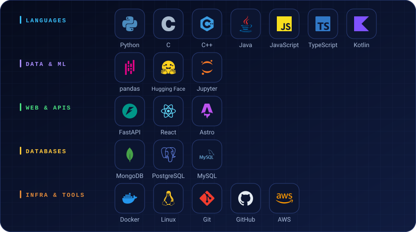</picture>

<h3 align="center"><picture><source media="(max-width: 531px), (min-width: 768px) and (max-width: 819px)" srcset="assets/sec-5-m.svg"><source media="(max-width: 767px), (min-width: 820px) and (max-width: 1099px)" srcset="assets/sec-5-t.svg"></picture></h3>

<picture><source media="(max-width: 531px), (min-width: 768px) and (max-width: 819px)" srcset="assets/stats-m.svg"><source media="(max-width: 767px), (min-width: 820px) and (max-width: 1099px)" srcset="assets/stats-t.svg">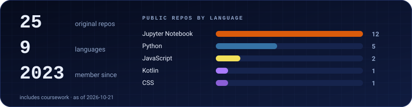</picture>

<h3 align="center"><picture><source media="(max-width: 531px), (min-width: 768px) and (max-width: 819px)" srcset="assets/sec-6-m.svg"><source media="(max-width: 767px), (min-width: 820px) and (max-width: 1099px)" srcset="assets/sec-6-t.svg"></picture></h3>

  

Open to internships and projects · <i>Disponible para pasantías y proyectos</i> — Quito, Ecuador

